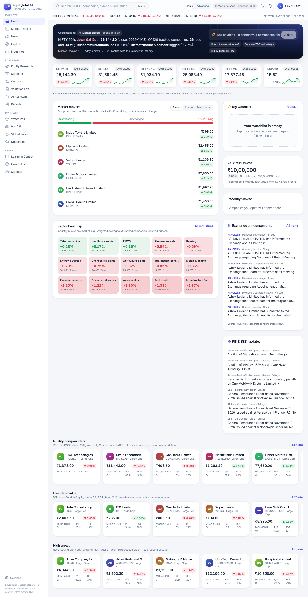
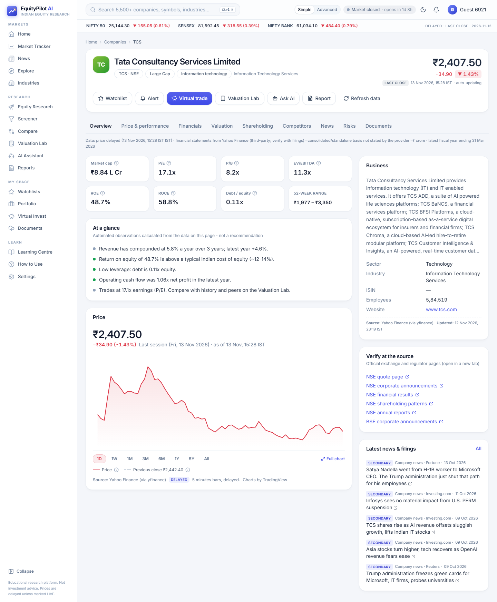

# EquityPilot AI

**Research Smarter. Understand Markets. Make Informed Decisions.**

EquityPilot AI is an Indian equity research platform. It covers:
- discovering companies and following markets, industries and news
- financial analysis, valuation and screening
- a source-grounded AI research assistant that can also answer questions about your own PDFs
- PDF research reports, portfolio analytics and a learning centre
- **Virtual Invest**, a paper-trading simulator with ₹10,00,000 of virtual money

It applies equity-research practice from the NISM Series XV (Research Analyst) curriculum and MBA finance: transparent formulas, labelled data sources, explicit assumptions and no buy or sell recommendations.



---

## What's inside

| Area | Pages and features |
|---|---|
| **Discover** | **Home**: indices, market movers, sector heat map, watchlist, recently viewed and Virtual Invest snapshot.<br>**Explore**: themed collections, AMFI large/mid/small-cap rows and trending companies.<br>**Industry Intelligence Centre**: 15 industries, each with drivers, risks, government policy and regulators (with official links), valuation approach, industry-specific metrics and recent filings.<br>**Market Tracker**: price charts in two modes. Simple shows one clean line, a hover readout and a labelled reference line. Advanced adds candles, moving averages, Bollinger bands, RSI and MACD. Ranges run from 1 day to all time, each line is explained in plain English, and quotes stream live. |
| **Research** | **Company pages**: overview, chart, statements, quarterly results, ratios, technicals, risk flags, peers, shareholding, bank metrics, news and notes.<br>**Equity Research** workspace.<br>**Valuation Lab**: an estimated-value range across methods, FCFF and FCFE DCF, margin of safety, scenarios, sensitivity, reverse DCF, historical P/E and P/B bands, peer multiples and justified P/B.<br>**Plain-English explanations**: click any ratio to see what it means, why it matters, how to read it, a worked example and its history. Ratings are applied only where a fair benchmark exists.<br>**Screener** with saved screens, and **Compare** for 2–5 companies.<br>**News & Market Intelligence**: NSE filings and results, RBI, SEBI and global markets.<br>**AI Assistant**, **Documents** (PDF question-answering with page citations) and **Reports** (PDF). |
| **My space** | **Watchlists**: several lists, with notes and price alerts that raise notifications.<br>**Portfolio**: value, XIRR, allocation, risk and correlation.<br>**Virtual Invest**: practice orders, P&L, allocation, performance vs NIFTY 50, achievements, an opt-in leaderboard and reset. |
| **Learn** | **Learning Centre**: 8 modules with quizzes and saved progress, plus a glossary.<br>**How to Use** guide.<br>**Settings**: account, theme, AI engine and costs, data sources, and export of your data. |

**Global search** (`Ctrl+K` or `/`) finds companies (5,552 listed securities), indices, sectors, financial concepts, research tools and news in one box. It is typo tolerant ("Adani Enterprwses"), knows everyday names (SBI, L&T, HUL), previews price and market cap, and keeps recent searches. Opening a company that isn't tracked yet fetches its data on demand.

**News & Market Intelligence** has 13 sections, from Top and Breaking (under 3 hours old only) to Commodities & currency and IPOs.
- **Sources:** official NSE, BSE, RBI and SEBI feeds first, then established publishers (The Economic Times, Mint, Business Standard and Reuters via Yahoo), each labelled.
- **Tools:** stories are de-duplicated across publishers; filters by company, sector, source and date; saved articles and related news.
- **Summary and explanations:** a fact-only daily market summary, and "What this means" explanations that separate confirmed filings from media reports.

A **Simple / Advanced** switch in the header changes how much detail every page shows, without losing your place.

| Company | Valuation Lab | Virtual Invest |
|---|---|---|
|  |  |  |

---

## Data integrity

1. **Nothing is invented.** Every figure comes from a named source or a calculation shown on screen. Missing data shows as "—".
2. **Every number is labelled:** `DELAYED` · `LAST CLOSE` · `HISTORICAL` · `THIRD-PARTY` · `OFFICIAL (UPLOADED)` · `USER-ENTERED` · `CALCULATED` · `ASSUMPTION` · `SAMPLE`. Each label comes with the source, period, statement basis and retrieval time in IST.
3. **Every headline carries a source label.** `OFFICIAL` means an exchange, regulator or government source. `SECONDARY` means an established news organisation; check material facts against the filing. Headlines from other publishers (tip sites, blogs, aggregators) are hidden by default and never used as evidence by the AI assistant.
4. **Only legitimate sources** (all verified in [docs/AUDIT.md](docs/AUDIT.md)):

   | Source | Used for |
   |---|---|
   | NSE public RSS feeds | Announcements and results, with links to the filings |
   | NSE `EQUITY_L.csv` | Listed securities |
   | AMFI market-cap list | Official large/mid/small-cap categories |
   | RBI and SEBI RSS | Regulatory and economic updates |
   | Yahoo Finance via `yfinance` | Delayed quotes, intraday and historical prices, statements, corporate actions, headlines |

   nseindia.com pages block automated clients (HTTP 403), so EquityPilot does not scrape them.
5. **No real-time prices.** Real-time NSE/BSE data needs a licensed vendor or a broker API on your own trading account, at roughly ₹0–500 per month depending on the broker. Prices go through a pluggable `MarketDataProvider`, so a broker adapter can be added later. Until then every price is labelled delayed.
6. **Edge cases are handled explicitly:**
   - Banks get bank metrics and justified P/B in place of EV/EBITDA and FCFF DCF.
   - Multiples are disabled for statements reported in USD.
   - Growth is left blank across a fiscal-year change.
   - Balance sheets that don't balance are flagged.
7. **Estimates are labelled as estimates.** Valuation outputs are called "estimated value", always shown next to the assumptions that produce them, and never presented as a target or the stock's true value.
8. **Works offline.** Five watermarked fictional sample companies, including a bank, let every feature run without internet access.

---

## Quick start

**Requirements:** Python 3.11+ (developed on 3.14) and Node.js 20+ (developed on 24).

**Windows, one click:** double-click **`start.bat`**. On the first run it creates the Python environment, installs the
packages and builds the web app (a few minutes); later runs start in seconds and open the browser. If the app is already
running, it just opens the browser.

**Manual setup (any OS):**

```bash
git clone https://github.com/Lalupratap-Yadav/EquityPilot-AI.git && cd EquityPilot-AI
python -m venv .venv
.venv\Scripts\activate              # macOS/Linux: source .venv/bin/activate
pip install -r requirements.txt

cd web && npm install && npm run build && cd ..
python -m uvicorn api.main:app --port 8000
```

Open **http://localhost:8000**. On first start:
- the database is created and the sample companies load;
- a background task fetches delayed quotes, the official feeds and the securities list;
- the first universe-metrics computation takes a few minutes, and Explore and Screener show a loading state until it finishes. After that, a saved snapshot loads immediately.

**Frontend development:** run `cd web && npm run dev` and open http://localhost:5173. Vite proxies `/api` to port 8000.

**Docker** (the Dockerfile is included but hasn't been build-tested here, because Docker isn't installed on the development machine):

```bash
docker build -t equitypilot .
docker run -p 8000:8000 -v equitypilot-data:/app/data equitypilot
```

**Classic workbench:** the original Streamlit app still works with `streamlit run app.py` (http://localhost:8501). Both apps share the same database and core.

### Configuration (environment variables)

| Variable | Purpose |
|---|---|
| `EQUITYPILOT_OFFLINE=1` | Sample data only; no network calls |
| `EQUITYPILOT_SECRET` | Session-signing key. If unset, one is generated in `data/secret.key` |
| `EQUITYPILOT_SECURE_COOKIES=1` | Mark cookies `Secure` when served over HTTPS |
| `EQUITYPILOT_DATA_DIR`, `EQUITYPILOT_DB` | Location of data and the SQLite database |
| `EQUITYPILOT_DATABASE_URL` | Use PostgreSQL instead of SQLite. The code path exists but hasn't been tested against a live server |
| `EQUITYPILOT_NO_WARMER=1` | Disable the background refresh tasks |
| `EQUITYPILOT_MEDIA_RSS=0` | Turn off the publisher RSS feeds (Economic Times, Mint, Business Standard); official feeds stay on |
| `EQUITYPILOT_LOG_JSON=1`, `EQUITYPILOT_SLOW_MS` | JSON log lines; threshold for slow-request warnings (default 2000 ms). Every API response carries `X-Request-ID` |
| `EQUITYPILOT_HOT_INTERVAL` | Seconds between in-session refreshes of indices and on-screen symbols (default 20) |
| `EQUITYPILOT_MARKET_PROVIDER=kite` + `KITE_API_KEY` + `KITE_ACCESS_TOKEN` | Paid and optional. Real-time quotes from your own Zerodha Kite Connect app. See [docs/MARKET_DATA.md](docs/MARKET_DATA.md) |
| `ANTHROPIC_API_KEY` + `EQUITYPILOT_SHARED_AI_KEY=1` | Paid and optional. Lets **all** users of the server use your Claude key. Without the opt-in flag, each user enters their own key in Settings |

### Tests

```bash
python -m pytest -q          # offline, temporary database
cd web && npx tsc -b         # TypeScript type-check
```

The suite covers:
- Analytics checked against hand calculations: ratios, DCF, WACC, reverse DCF, indicators, Altman Z″ and XIRR.
- Upload parsers and the assistant's grounding rules.
- PDF reports and a render of every Streamlit page.
- API tests for:
  - guest sessions and per-user data isolation (watchlists, documents)
  - registration and login (scrypt hashing)
  - Virtual Invest rules: no overspending or overselling, plus split and dividend adjustment
  - alerts, DCF, bank metrics, shareholding entry and document question-answering
  - the refusal to give recommendations, plus security headers and input validation

### Command-line refresh

```bash
python -m equitypilot status
python -m equitypilot refresh [--quotes-only] [--news] [--symbols TCS INFY]
```

---

## AI assistant: engines and costs

| Engine | Cost | Notes |
|---|---|---|
| **Offline analyst** (default) | Free | Rule-based router over the research tools. It answers market questions ("How is the market today?"), comparisons ("Compare TCS and Infosys"), screens ("Top 10 IT companies by ROE", "debt-free companies"), news, single-company questions and concepts. Companies can be named in the question. It also quotes relevant passages from your PDFs |
| **Claude API** (optional) | Paid per use | A tool-using research agent. Claude chooses which tools to call: find a company, a company's research pack, price performance, compare, screen, market overview, news, your documents and the metric guide. It then writes a cited answer that streams to the browser. Uses your own Anthropic API key. Settings shows the estimated cost, and you must tick a consent box. The key stays in your session cookie |
| **Ollama** (optional) | Free | A local open-source model, given the data the offline router gathered |

Every engine reads the same source-tagged tool results ([T1], [S1] ...). LLM answers go through a grounding check that flags any figure not found in the data. The answer screen shows each research step as it runs. The assistant declines buy, sell or hold requests.

---

## Architecture

```
api/            FastAPI app: routers for market, company, explore, user, invest, research;
                guest sessions, rate limiting, security headers; serves web/dist
web/            React 19 + TypeScript + Vite + Tailwind v4 SPA (TanStack Query, lightweight-charts, Recharts)
equitypilot/    framework-independent core (shared with the Streamlit workbench)
  data/         securities master · feeds (NSE/RBI/SEBI) · marketdata (provider, quote cache, indices, corporate actions)
                yahoo · repository · uploads · sample
  analytics/    ratios · valuation · screener · technicals · risk · bank · portfolio · paper (Virtual Invest)
  ai/           grounded context · offline analyst · providers · rag (BM25 passages with page numbers)
  content/      industries (15) · learning modules · glossary
  reports/      PDF and Excel
  users.py · db.py · config.py · formatting.py
app.py, views/  Streamlit classic workbench
tests/          pytest suite
```

Design notes:
- **Cache first.** Pages read from SQLite and in-process caches. A background task refreshes quotes (every 90 s while the market is open) and feeds.
- **Universe metrics** are stale-while-revalidate and persisted to disk.
- **Live updates.** Quotes are pushed to the browser over a WebSocket.
- **Database.** SQLAlchemy Core with additive migrations runs on SQLite by default, and Postgres is optional.

See [docs/AUDIT.md](docs/AUDIT.md) for why FastAPI + React was chosen and why Redis and PostgreSQL were not needed by default.

---

## Deployment and demo

- [docs/DEPLOYMENT.md](docs/DEPLOYMENT.md): GitHub, Docker or any container host, and the Streamlit Cloud option for the classic workbench.
- [docs/DEMO_SCRIPT.md](docs/DEMO_SCRIPT.md): a 7-minute walkthrough.

## Known limitations

- **Prices** are delayed (about 15 minutes) or end-of-day by default. In session they auto-update every 20 seconds, but they aren't real-time. Real-time quotes need the optional, paid Zerodha Kite Connect connector, which has been tested only against mocked responses (see [docs/MARKET_DATA.md](docs/MARKET_DATA.md)).
- **First minute after a restart:** some pages respond slowly while the background warm-up runs; index tiles are served from a saved snapshot meanwhile.
- **Publisher headlines** come from the publishers' own RSS feeds (headline, short description, link) for personal, non-commercial research; full articles are read on the publisher's site.
- **Statements** from Yahoo cover 4–5 years and don't state whether they're consolidated or standalone. Shareholding and bank metrics have to be entered from filings.
- **PDFs** must contain text. Scanned PDFs are detected, but OCR isn't included.
- **Alerts** are checked against the latest delayed price while the server is running. There are no push or SMS notifications.
- **Portfolio risk** statistics apply today's weights to past returns.
- **Universe metrics** take a few minutes to compute on a fresh install, roughly 1 s per tracked company.

## Disclaimer

EquityPilot AI is an **educational research tool**. It is not investment advice and does not issue buy, sell or hold recommendations. Virtual Invest uses virtual money only and places no real orders. Neither the tool nor its author is registered with SEBI as a Research Analyst or Investment Adviser. Data may be delayed or inaccurate, so verify it against official filings before relying on it.
