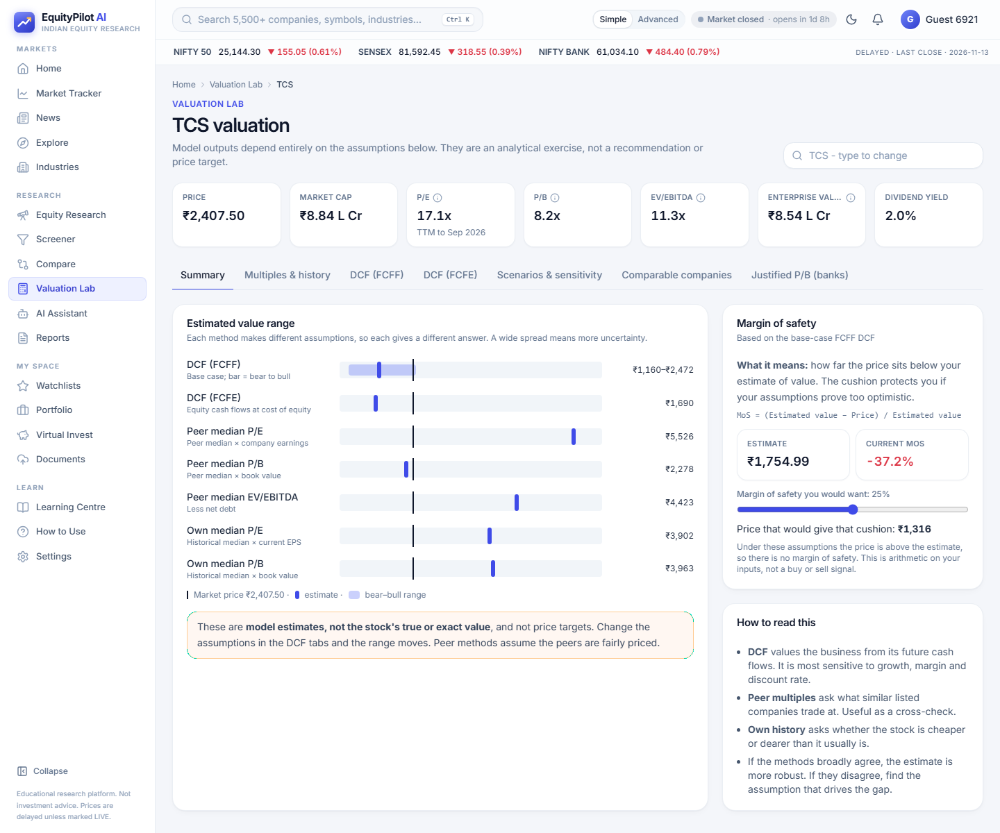
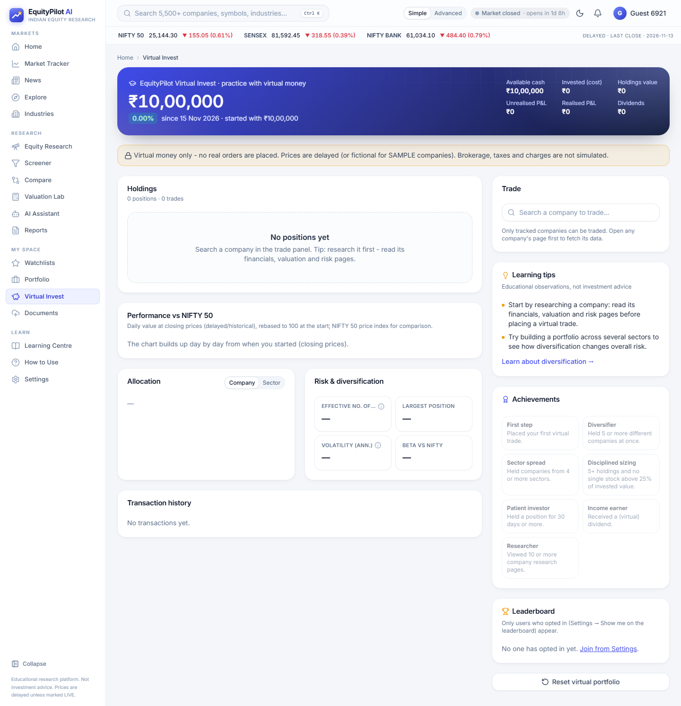

# EquityPilot AI

**Research Smarter. Understand Markets. Make Informed Decisions.**

EquityPilot AI is an Indian equity research platform. It covers:
- discovering companies and following markets, industries and news
- financial analysis, valuation, a rule-based financial health check and screening
- an earnings & results calendar and a corporate actions centre built from official exchange filings
- a source-grounded AI research assistant that can also answer questions about your own PDFs
- PDF research reports, portfolio analytics and a learning centre
- **Virtual Invest**, a paper-trading simulator with ₹10,00,000 of virtual money

It applies equity-research practice from the NISM Series XV (Research Analyst) curriculum and MBA finance: transparent formulas, labelled data sources, explicit assumptions and no buy or sell recommendations.


---

## What's inside

| Area | Pages and features |
|---|---|
| **Discover** | **Home**: indices, market movers, sector heat map, watchlist, recently viewed and Virtual Invest snapshot.<br>**Explore**: themed collections, AMFI large/mid/small-cap rows and trending companies.<br>**Industry Intelligence Centre**: 15 industries, each with drivers, risks, government policy and regulators (with official links), valuation approach, industry-specific metrics and recent filings.<br>**Market Tracker**: price charts in two modes. Simple shows one clean line with a soft gradient fill, a hover readout and a labelled reference line. Advanced adds candles, moving averages, Bollinger bands, RSI and MACD. Ranges run from 1 day to all time, each line is explained in plain English, and quotes stream live.<br>**Earnings & Results**: confirmed result dates from companies' board-meeting filings with NSE (list and calendar), results as they are filed, and each company's quarterly history. Nothing is estimated.<br>**Corporate Actions**: dividends, splits, bonus issues, rights, buybacks and schemes with the exchange's ex-date and record date, plus plain-English explanations. |
| **Research** | **Company pages**: overview, chart, statements, a **Financial Health** check (seven areas, each with its metrics, formulas and rating rule; bank-specific for banks), quarterly results, ratios, technicals, risk flags, peers, shareholding, bank metrics, news, documents and a data-coverage view.<br>**Equity Research** workspace.<br>**Valuation Lab**: an estimated-value range across methods, FCFF and FCFE DCF, margin of safety, scenarios, sensitivity, reverse DCF, historical P/E and P/B bands, peer multiples and justified P/B.<br>**Plain-English explanations**: click any ratio to see what it means, why it matters, how to read it, a worked example and its history. Ratings are applied only where a fair benchmark exists.<br>**Screener** with saved screens, and **Compare** for 2–5 companies.<br>**News & Market Intelligence**: NSE filings and results, RBI, SEBI and global markets.<br>**AI Assistant**, **Documents** (PDF question-answering with page citations) and **Reports** (PDF). |
| **My space** | **Watchlists**: several lists, with notes and price alerts that raise notifications.<br>**Portfolio**: value, XIRR, allocation, risk and correlation.<br>**Virtual Invest**: practice orders, P&L, allocation, performance vs NIFTY 50, achievements, an opt-in leaderboard and reset. |
| **Learn** | **Learning Centre**: 8 modules with quizzes and saved progress, plus a glossary.<br>**How to Use** guide.<br>**Data Quality**: status and freshness of every source, label glossary, EPS consistency warnings and per-company coverage.<br>**Settings**: account, theme, AI engine and costs, data sources, and export of your data. |

**Global search** (`Ctrl+K` or `/`) finds companies (5,552 listed securities), indices, sectors, financial concepts, research tools and news in one box. It is typo tolerant ("Adani Enterprwses"), knows everyday names (SBI, L&T, HUL), previews price and market cap, and keeps recent searches. Opening a company that isn't tracked yet fetches its data on demand.

**News & Market Intelligence** has 13 sections, from Top and Breaking (under 3 hours old only) to Commodities & currency and IPOs.
- **Sources:** official NSE, BSE, RBI and SEBI feeds first, then established publishers (The Economic Times, Mint, Business Standard and Reuters via Yahoo), each labelled.
- **Company matching:** a story is linked to a company only when the exchange names it or the company is clearly named in the headline or summary. Group names ("Tata", "HDFC"), foreign parents ("Nestle") and similar names ("HDFC Life" vs "HDFC Bank") are handled; every link says how it was made, and anything uncertain stays general market news.
- **Tools:** stories are de-duplicated across publishers; filters by company, sector, source and date; saved articles and related news.
- **Summary and explanations:** a fact-only daily market summary, and "What this means" explanations that separate confirmed filings from media reports.

A **Simple / Advanced** switch in the header changes how much detail every page shows, without losing your place.

| Company | Valuation Lab | Virtual Invest |
|---|---|---|
|  |  |  |

---

## Data integrity

1. **Nothing is invented.** Every figure comes from a named source or a calculation shown on screen. Missing data shows as "—".
2. **Every number is labelled:** `OFFICIAL` · `SECONDARY` · `THIRD-PARTY` · `DELAYED` · `LAST CLOSE` · `HISTORICAL` · `OFFICIAL (UPLOADED)` · `USER-ENTERED` · `CALCULATED` · `ASSUMPTION` · `SAMPLE`. The Data Quality page lists them all. Each label comes with the source, period, statement basis and retrieval time in IST.
3. **Every headline carries a source label.** `OFFICIAL` means an exchange, regulator or government source. `SECONDARY` means an established news organisation; check material facts against the filing. Headlines from other publishers (tip sites, blogs, aggregators) are hidden by default and never used as evidence by the AI assistant.
4. **Only legitimate sources** (all verified in [docs/AUDIT.md](docs/AUDIT.md)):

   | Source | Used for |
   |---|---|
   | NSE public RSS feeds | Announcements, results, board meetings (result dates) and corporate actions (ex-dates), with links to the filings |
   | NSE `EQUITY_L.csv` | Listed securities |
   | AMFI market-cap list | Official large/mid/small-cap categories |
   | RBI and SEBI RSS | Regulatory and economic updates |
   | Yahoo Finance via `yfinance` | Delayed quotes, intraday and historical prices, statements, corporate actions, headlines |

   nseindia.com pages block automated clients (HTTP 403), so EquityPilot does not scrape them.
5. **No real-time prices.** Real-time NSE/BSE data needs a licensed vendor or a broker API on your own trading account, at roughly ₹0–500 per month depending on the broker. Prices go through a pluggable `MarketDataProvider`, so a broker adapter can be added later. Until then every price is labelled delayed.
6. **Edge cases are handled explicitly:**
   - Banks get bank metrics and justified P/B in place of EV/EBITDA and FCFF DCF.
   - Multiples are disabled for statements reported in USD.
   - Growth is left blank across a fiscal-year change.
   - Balance sheets that don't balance are flagged.
7. **Estimates are labelled as estimates.** Valuation outputs are called "estimated value", always shown next to the assumptions that produce them, and never presented as a target or the stock's true value.
8. **Works offline.** Five watermarked fictional sample companies, including a bank, let every feature run without internet access.

---

## Quick start

**Requirements:** Python 3.11+ (developed on 3.14) and Node.js 20+ (developed on 24).

**Windows, one click:** double-click **`start.bat`**. On the first run it creates the Python environment, installs the
packages and builds the web app (a few minutes); later runs start in seconds and open the browser. If the app is already
running, it just opens the browser.

**Manual setup (any OS):**

```bash
git clone https://github.com/Lalupratap-Yadav/EquityPilot-AI.git && cd EquityPilot-AI
python -m venv .venv
.venv\Scripts\activate              # macOS/Linux: source .venv/bin/activate
pip install -r requirements.txt

cd web && npm install && npm run build && cd ..
python -m api --port 8000          # listens on 127.0.0.1 and ::1 only (python -m uvicorn api.main:app also works)
```

Open **http://localhost:8000**. On first start:
- the database is created and the sample companies load;
- a background task fetches delayed quotes, the official feeds and the securities list;
- the first universe-metrics computation (about 8 seconds) runs in a background worker process. Later restarts show the
  saved snapshot at once and refresh it in the background.

**Frontend development:** run `cd web && npm run dev` and open http://localhost:5173. Vite proxies `/api` to port 8000.

**Docker** (the Dockerfile is included but hasn't been build-tested here, because Docker isn't installed on the development machine):

```bash
docker build -t equitypilot .
docker run -p 8000:8000 -v equitypilot-data:/app/data equitypilot
```

**Classic workbench:** the original Streamlit app still works with `streamlit run app.py` (http://localhost:8501). Both apps share the same database and core.

### Configuration (environment variables)

| Variable | Purpose |
|---|---|
| `EQUITYPILOT_OFFLINE=1` | Sample data only; no network calls |
| `EQUITYPILOT_SECRET` | Session-signing key. If unset, one is generated in `data/secret.key` |
| `EQUITYPILOT_SECURE_COOKIES=1` | Mark cookies `Secure` when served over HTTPS |
| `EQUITYPILOT_DATA_DIR`, `EQUITYPILOT_DB` | Location of data and the SQLite database |
| `EQUITYPILOT_DATABASE_URL` | Use PostgreSQL instead of SQLite. The code path exists but hasn't been tested against a live server |
| `EQUITYPILOT_NO_WARMER=1` | Disable the background refresh tasks |
| `EQUITYPILOT_WORKER_PROCESS=0` | Run bulk quote downloads, metrics recomputes and news rebuilds in the server process instead of the background worker process |
| `EQUITYPILOT_MEDIA_RSS=0` | Turn off the publisher RSS feeds (Economic Times, Mint, Business Standard); official feeds stay on |
| `EQUITYPILOT_LOG_JSON=1`, `EQUITYPILOT_SLOW_MS` | JSON log lines; threshold for slow-request warnings (default 2000 ms). Every API response carries `X-Request-ID` |
| `EQUITYPILOT_HOT_INTERVAL` | Seconds between in-session refreshes of indices and on-screen symbols (default 20) |
| `EQUITYPILOT_MARKET_PROVIDER=kite` + `KITE_API_KEY` + `KITE_ACCESS_TOKEN` | Paid and optional. Real-time quotes from your own Zerodha Kite Connect app. See [docs/MARKET_DATA.md](docs/MARKET_DATA.md) |
| `ANTHROPIC_API_KEY` + `EQUITYPILOT_SHARED_AI_KEY=1` | Paid and optional. Lets **all** users of the server use your Claude key. Without the opt-in flag, each user enters their own key in Settings |

### Tests

```bash
python -m pytest -q          # offline, temporary database (323 tests)
cd web && npx tsc -b         # TypeScript type-check
cd web && npm test           # frontend interaction tests (Vitest + Testing Library, 22 tests)
```

The suite covers:
- Analytics checked against hand calculations: ratios, DCF, WACC, reverse DCF, indicators, Altman Z″ and XIRR.
- Upload parsers and the assistant's grounding rules.
- PDF reports and a render of every Streamlit page.
- API tests for:
  - guest sessions and per-user data isolation (watchlists, documents)
  - registration and login (scrypt hashing)
  - Virtual Invest rules: no overspending or overselling, plus split and dividend adjustment
  - alerts, DCF, bank metrics, shareholding entry and document question-answering
  - the refusal to give recommendations, plus security headers and input validation
- Company identification in news with misleading headlines, earnings and corporate-action parsing, financial health,
  data coverage, split and dividend accounting, search ranking across the securities master, and cross-user privacy
  (holdings, trades, saved articles, alerts, portfolio).
- Frontend interaction tests for search and keyboard navigation, desktop and phone navigation, the Earnings, Corporate
  Actions, Data Quality and Health views, news company links and filters, Virtual Invest order checks and error states,
  and the AI assistant (streamed steps, clickable sources, flagged figures, retry, saved conversation).
  They use a fake API, so they test the interface, not live data.
- Speed-ups that must not change results: statement and ratio caches (and their invalidation), the news de-duplication
  index against the original all-pairs rule, quote and chart caches, the worker process (same output as in-process, exits
  with the server), non-blocking pages, and the assistant's question understanding, direct answers, follow-ups, document
  summaries, refusal fallbacks and cost estimates (with a fake Claude client - no paid calls).

### Command-line refresh

```bash
python -m equitypilot status
python -m equitypilot refresh [--quotes-only] [--news] [--symbols TCS INFY]
```

---

## AI assistant: engines and costs

| Engine | Cost | Notes |
|---|---|---|
| **Offline analyst** (default) | Free | Rule-based router over the research tools, for questions in everyday words: the market ("What is happening in Indian markets?"), comparisons ("Compare TCS and Infosys", "which has better margins?"), screens with conditions ("Which companies have ROE above 20%?", "IT stocks with P/E below 25"), one metric ("debt-to-equity of Tata Motors"), the latest quarterly results, a plain-English explanation of a company, news, concepts and summaries of your PDFs with page numbers. Follow-up questions ("what about its debt?") continue with the same company. Answers start with a direct answer, then the cited figures, calculations, a plain-English reading, limitations and the sources and periods used |
| **Claude API** (optional) | Paid per use | A tool-using research agent. EquityPilot first fetches the data a predictable question needs (in parallel), so most questions need one model turn; Claude then writes a cited answer, looking up anything else with the same tools. Answers stream to the browser. Uses your own Anthropic API key and your consent; Settings shows the estimated cost, and each answer shows its own. "Answer depth" (quick / balanced / thorough) trades speed and cost for detail. If the API declines a request on safety grounds, the API retries it on another Claude model automatically; if a request fails (bad key, no credit, rate limit), the free offline analyst answers instead and says why |
| **Ollama** (optional) | Free | A local open-source model, given the data the offline router gathered |

**Claude API billing is separate from Claude subscriptions:** a Claude Pro or Max plan, or Claude Code access, does not include
API usage. The API is billed per token to an Anthropic API account (console.anthropic.com). EquityPilot never calls it
without your own key and your consent.

Every engine reads the same source-tagged tool results ([T1], [S1] ...). Every LLM answer is checked against the data it
was given: figures not found there, citations to sources that were never retrieved and figures the model calculated are
reported with the answer, never hidden. Click a source tag to see the source. The answer screen shows each research step,
and offers Stop, Retry and Copy. The assistant declines buy, sell or hold requests.

---

## Architecture

```
api/            FastAPI app: routers for market, company, explore, user, invest, research;
                guest sessions, rate limiting, security headers; serves web/dist
web/            React 19 + TypeScript + Vite + Tailwind v4 SPA (TanStack Query, lightweight-charts, Recharts)
equitypilot/    framework-independent core (shared with the Streamlit workbench)
  data/         securities master · feeds (NSE/RBI/SEBI) · marketdata (provider, quote cache, indices, corporate actions)
                yahoo · repository · uploads · sample
  analytics/    ratios · valuation · screener · technicals · risk · bank · portfolio · paper (Virtual Invest)
  ai/           grounded context · offline analyst · providers · rag (BM25 passages with page numbers)
  content/      industries (15) · learning modules · glossary
  reports/      PDF and Excel
  users.py · db.py · config.py · formatting.py
app.py, views/  Streamlit classic workbench
tests/          pytest suite
```

Design notes:
- **Cache first, never wait for a provider.** Pages read from SQLite and in-process caches; quotes, chart bars and news
  are served at once and refreshed in the background (stale-while-revalidate). Each figure carries its own timestamp.
- **A worker process** does the CPU-heavy background jobs - bulk quote downloads, universe-metrics recomputes and news
  rebuilds - so request handling keeps the CPU. It exits with the server. See [docs/PERFORMANCE.md](docs/PERFORMANCE.md).
- **Universe metrics** are stale-while-revalidate and persisted to disk; statement-based figures are cached per company
  until its statements change.
- **Live updates.** Quotes are pushed to the browser over a WebSocket.
- **Database.** SQLAlchemy Core with additive migrations runs on SQLite by default, and Postgres is optional.

See [docs/AUDIT.md](docs/AUDIT.md) for why FastAPI + React was chosen and why Redis and PostgreSQL were not needed by default.

---

## Deployment and demo

- [docs/DEPLOYMENT.md](docs/DEPLOYMENT.md): GitHub, Docker or any container host, and the Streamlit Cloud option for the classic workbench.
- [docs/DEMO_SCRIPT.md](docs/DEMO_SCRIPT.md): a 7-minute walkthrough.

## Known limitations

- **Prices** are delayed (about 15 minutes) or end-of-day by default. In session they auto-update every 20 seconds, but they aren't real-time. Real-time quotes need the optional, paid Zerodha Kite Connect connector, which has been tested only against mocked responses (see [docs/MARKET_DATA.md](docs/MARKET_DATA.md)).
- **First seconds after a restart:** pages answer from saved data at once; the first chart of a symbol waits for the
  provider's first connection (3-10 s), and News can take a few seconds the very first time.
- **Publisher headlines** come from the publishers' own RSS feeds (headline, short description, link) for personal, non-commercial research; full articles are read on the publisher's site.
- **Statements** from Yahoo cover 4–5 years and don't state whether they're consolidated or standalone. Shareholding and bank metrics have to be entered from filings.
- **PDFs** must contain text. Scanned PDFs are detected, but OCR isn't included.
- **Alerts** are checked against the latest delayed price while the server is running. There are no push or SMS notifications.
- **Portfolio risk** statistics apply today's weights to past returns.
- **Universe metrics** take about 8 seconds to compute on a fresh install (in the background worker).

## Disclaimer

EquityPilot AI is an **educational research tool**. It is not investment advice and does not issue buy, sell or hold recommendations. Virtual Invest uses virtual money only and places no real orders. Neither the tool nor its author is registered with SEBI as a Research Analyst or Investment Adviser. Data may be delayed or inaccurate, so verify it against official filings before relying on it.
