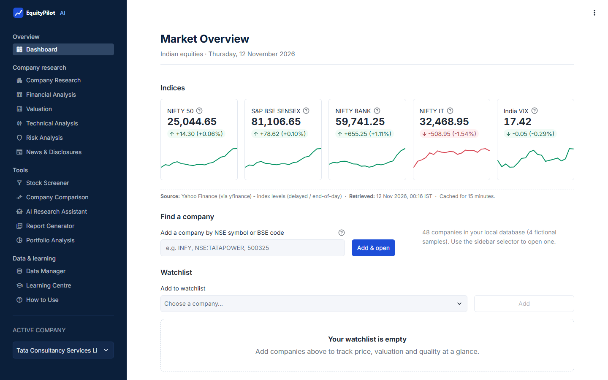
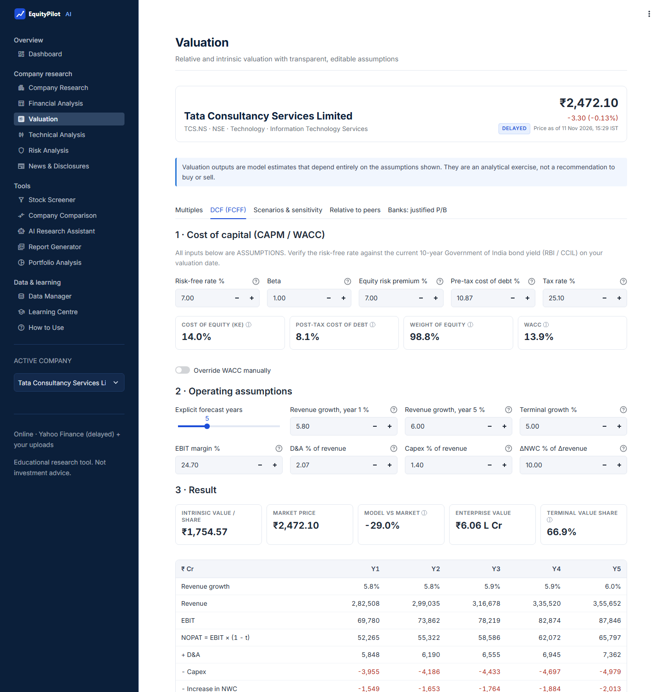
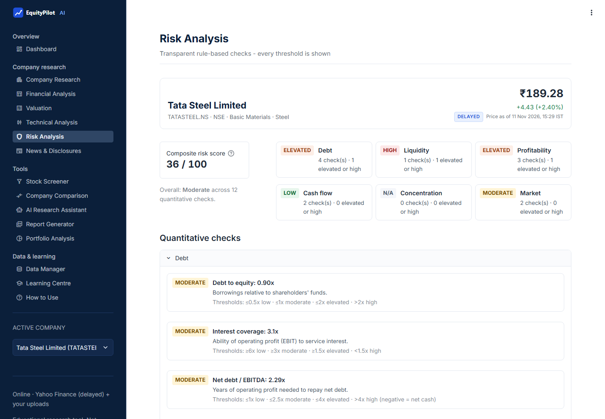
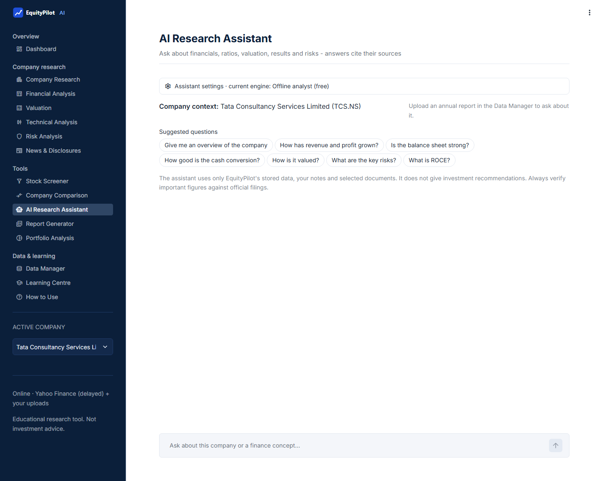

# EquityPilot AI

**Indian Equity Research & Financial Intelligence Platform**

EquityPilot AI is a research workbench for Indian listed companies. It brings financial statements, ratio analysis, valuation (multiples and DCF), screening, technical and risk analysis, news and disclosures, a source-grounded AI research assistant, PDF research reports, portfolio analytics and a NISM Series XV learning centre into one Streamlit application.

It was built to demonstrate equity-research practice as taught in the NISM Series XV (Research Analyst) curriculum and MBA finance: transparent formulas, labelled data sources, explicit assumptions and no unsupported recommendations.



---

## Features

| Module | What it does |
|---|---|
| **Dashboard** | NIFTY 50, SENSEX, NIFTY Bank, NIFTY IT and India VIX (delayed); company search; watchlist; gainers, losers and sector moves; recent activity |
| **Company Research** | Profile, key metrics, business-model notes, revenue segments, shareholding (with pledge flags), editable peer group, official NSE/BSE/SEBI links |
| **Financial Analysis** | Income statement, balance sheet and cash flow (annual and quarterly) in ₹ crore; 25 ratios with formulas; DuPont; Piotroski F-score; trends; CAGR; data-quality checks; Excel/CSV export |
| **Valuation** | P/E, P/B, EV/EBITDA with history; CAPM/WACC builder; FCFF DCF with every step shown; bear/base/bull scenarios; WACC × g sensitivity; reverse DCF; peer-relative valuation; justified P/B for banks |
| **Stock Screener** | Presets (quality compounders, low-debt value, growth, cash generators, dividend payers) plus custom filters on ROE, ROCE, D/E, P/E, growth, margins and more; open, compare or watchlist results; CSV export |
| **Company Comparison** | 2–5 companies side by side; warnings when fiscal periods, statement bases or currencies differ; indexed revenue and price-performance charts |
| **Technical Analysis** | Candlesticks; SMA/EMA/Bollinger overlays; volume; RSI; MACD; returns; volatility; drawdown; ATR; beta vs NIFTY 50 |
| **Risk Analysis** | Rule-based checks for debt, liquidity, profitability, cash flow, concentration and market risk, each with its threshold shown; Altman Z″; sector considerations; your own risk notes |
| **News & Disclosures** | Third-party headlines with publisher and time; a log of exchange disclosures with filing links; uploaded documents; official links |
| **AI Research Assistant** | Answers about the company's data, ratios, valuation, risks and uploaded annual reports, citing numbered sources. Answers are split into facts, calculations, assumptions, interpretation and limitations. Free offline engine by default; Claude API or Ollama optional |
| **Report Generator** | Professional PDF with tables, charts, DCF assumptions, scenarios, sensitivity, risk table, source list and SEBI-aware disclosures |
| **Portfolio Analysis** | Holdings (lots), value, P&L, XIRR, allocation by stock and sector, concentration (HHI, effective N), volatility, Sharpe, drawdown, beta, diversification ratio, risk contribution, correlation |
| **Learning Centre** | 8 modules (markets, research-analyst regulation, statements, ratios, valuation, technicals, risk, corporate actions) with formulas, live worked examples, 39 quiz questions and a glossary |
| **Data Manager** | Source register; cache status; refresh; statement upload (template provided) with review and correction; NSE/BSE price CSV upload; PDF text and table extraction with search |
| **How to Use** | Interactive quick-start tour with progress, a guide for every module, data-label legend and FAQ |

| Valuation (DCF) | Risk analysis | AI assistant |
|---|---|---|
|  |  |  |

---

## Data integrity principles

1. **No fabricated numbers.** Figures come from a named source or from a calculation shown on screen. Missing data stays missing (shown as "—"); it is never filled with estimates.
2. **Every number is labelled**: `SAMPLE` · `DELAYED` · `HISTORICAL` · `THIRD-PARTY` · `OFFICIAL (UPLOADED)` · `USER-ENTERED` · `CALCULATED` · `ASSUMPTION`, together with its source, period, statement basis and retrieval time (IST).
3. **Honest sourcing**:
   - **Yahoo Finance (via `yfinance`)** is a secondary source used for delayed quotes, price history, summarised statements (4–5 years) and headlines.
   - **NSE** has no public developer API and blocks automated access (verified: HTTP 403). EquityPilot does **not** scrape NSE or BSE. It links to their official pages and lets you upload downloaded files.
   - **Official figures** from annual reports and results can be uploaded (CSV/Excel template, or PDF extraction), reviewed, corrected and stored with your source citation and the consolidated or standalone basis.
4. **Edge cases handled explicitly.**
   - Banks: EV/EBITDA, D/E and FCFF DCF are marked not meaningful, and justified P/B is offered instead.
   - Statements reported in USD (e.g. Infosys, HCLTech on Yahoo): price multiples are disabled, while ratios stay valid.
   - Fiscal-year changes (e.g. Nestlé India): year-on-year growth is left blank across the irregular period.
   - Balance-sheet mismatches are flagged.
5. **Works offline.** Four clearly watermarked **fictional** sample companies let every feature run without internet access, and they drive the automated tests.

---

## Quick start

**Requirements:** Python 3.11 or newer (developed on 3.14) and Git.

```bash
git clone <your-repo-url> EquityPilot-AI
cd EquityPilot-AI
python -m venv .venv
# Windows:
.venv\Scripts\activate
# macOS/Linux:
source .venv/bin/activate
pip install -r requirements.txt
streamlit run app.py
```

Open http://localhost:8501. On first start the database is created and the sample companies load automatically. To work with real data, open the **Dashboard** and either click **Load default research universe** (44 large NSE companies, about 2–4 minutes) or add any NSE symbol.

**Offline mode** (sample data only, no network calls):

```bash
# Windows PowerShell
$env:EQUITYPILOT_OFFLINE="1"; streamlit run app.py
# macOS/Linux
EQUITYPILOT_OFFLINE=1 streamlit run app.py
```

### Run the tests

```bash
python -m pytest -q
```

There are 100+ tests. They cover:
- Hand-calculated checks of the ratios, DCF, WACC, reverse DCF, technical indicators, Altman Z″ and XIRR.
- The upload parsers and PDF extraction.
- The assistant's grounding rules: every figure must be traceable to a source, and recommendation requests are declined.
- PDF report generation.
- A Streamlit `AppTest` render of every page, for every sample company.

The tests run offline against a temporary database.

---

## AI assistant: engines and costs

| Engine | Cost | Notes |
|---|---|---|
| **Offline analyst** (default) | Free | Deterministic and rule-based. Uses only the cited sources; extractive summaries of uploaded PDFs |
| **Claude API** (optional) | Paid per use | Needs your own Anthropic API key with billing; **a Claude Pro chat subscription does not include API credits**. Indicative cost: about $0.001 (Haiku 5.5) to about $0.05 (Opus 5.5) per question with company data; costs are shown in-app before enabling |
| **Ollama** (optional) | Free | Runs an open-source model locally (`ollama pull llama3.1:8b`). Smaller models follow grounding rules less reliably |

All engines receive the same numbered, provenance-tagged context. For LLM answers, a grounding check reports how many figures in the answer can be traced back to the sources. The API key is read from `.streamlit/secrets.toml` or the `ANTHROPIC_API_KEY` environment variable, or entered for the session only, and is never stored.

---

## Architecture

```
app.py                      entry point: theme, navigation, global company picker
equitypilot/
  config.py                 paths, data-type labels, freshness rules
  db.py                     SQLite schema (SQLAlchemy Core) - provenance columns on every table
  formatting.py             ₹ / crore / % formatting, IST timestamps, FY labels, input sanitising
  data/                     schema · universe · yahoo provider · official links · sample data · uploads · repository
  analytics/                ratios · valuation · screener · technicals · risk · portfolio
  ai/                       context (grounded sources) · offline analyst · providers (Claude / Ollama)
  reports/pdf_report.py     ReportLab + matplotlib research report
  content/                  glossary · learning modules & quizzes
  ui/                       theme (CSS) · components · charts (Plotly)
views/                      one file per page
tests/                      pytest suite (offline)
docs/                       deployment guide, demo script, screenshots
```

All pages read data through `data/repository.py`. It is cache-first: it serves from SQLite and refreshes from the provider when data is stale. A provider failure never crashes a page; cached data is shown with its retrieval time.

**Stack:** Python · Streamlit · pandas/NumPy · Plotly · SQLite/SQLAlchemy · yfinance · pdfplumber · openpyxl · ReportLab · matplotlib · Anthropic SDK (optional) · pytest

---

## Deployment

See [docs/DEPLOYMENT.md](docs/DEPLOYMENT.md) for Streamlit Community Cloud (free), Hugging Face Spaces and local network options.

## Demo

See [docs/DEMO_SCRIPT.md](docs/DEMO_SCRIPT.md) for a 7-minute walkthrough for interviews.

---

## Known limitations

- Market data is delayed or end-of-day; there is no real-time feed.
- Yahoo Finance typically provides 4–5 fiscal years of statements and does not state the consolidated/standalone basis.
- Exchange disclosures cannot be fetched automatically (no public API); they are logged manually with links.
- PDF extraction needs text-based PDFs. Scanned documents are detected, but OCR is not included.
- Portfolio risk statistics apply current weights to past returns (an ex-post approximation).
- On free cloud hosting, the SQLite database resets when the app restarts.

## Disclaimer

EquityPilot AI is an **educational research tool**. It is not investment advice and does not issue buy, sell or hold recommendations. Neither the tool nor its author is registered with SEBI as a Research Analyst or Investment Adviser. Data may be delayed or inaccurate; verify against official filings before relying on it.
